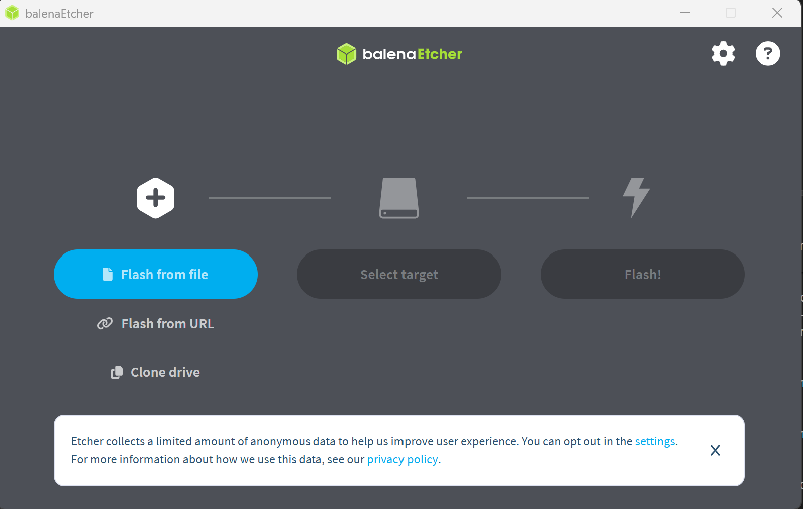

## Etcher

 

* Etcher Download  
https://etcher.balena.io/#download-etcher    
* Win32 Disk Imager  
이전에 많이 사용했으나, 거의 Etcher로 사용  
https://sourceforge.net/projects/win32diskimager/
* SD card Fommater  
https://www.sdcard.org/downloads/formatter/sd-memory-card-formatter-for-windows-download/   

 

* 주요기능   
Iso 파일을 USB or SD Card에 Write할 때 주로 사용   

 

### Etcher

 

  

 

### Rufus 

 

주로 PC용 USB BIOS 기반의 MBR을 이용할때 사용   