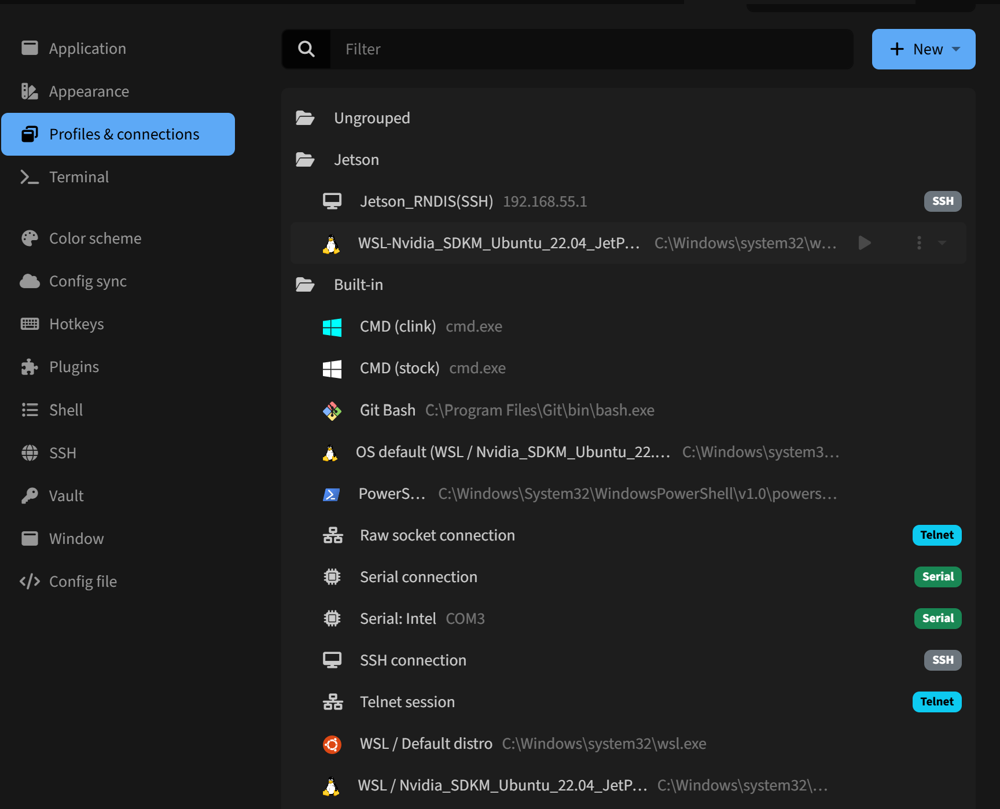
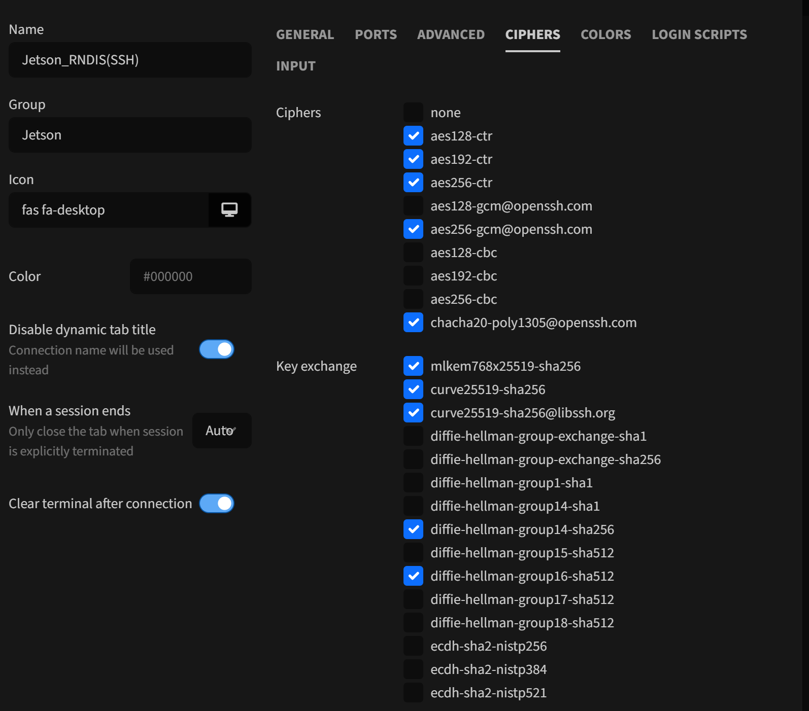
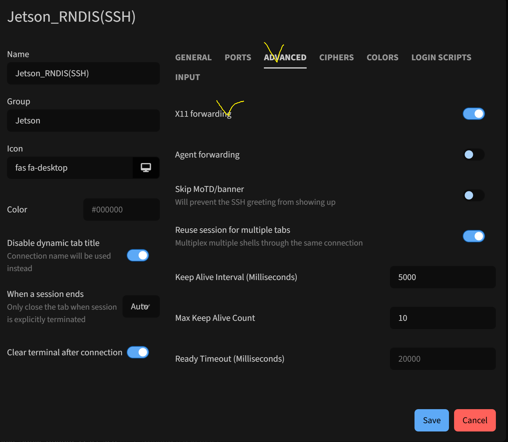
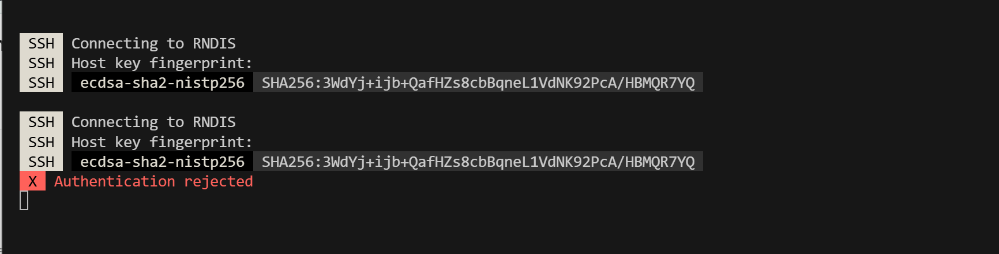
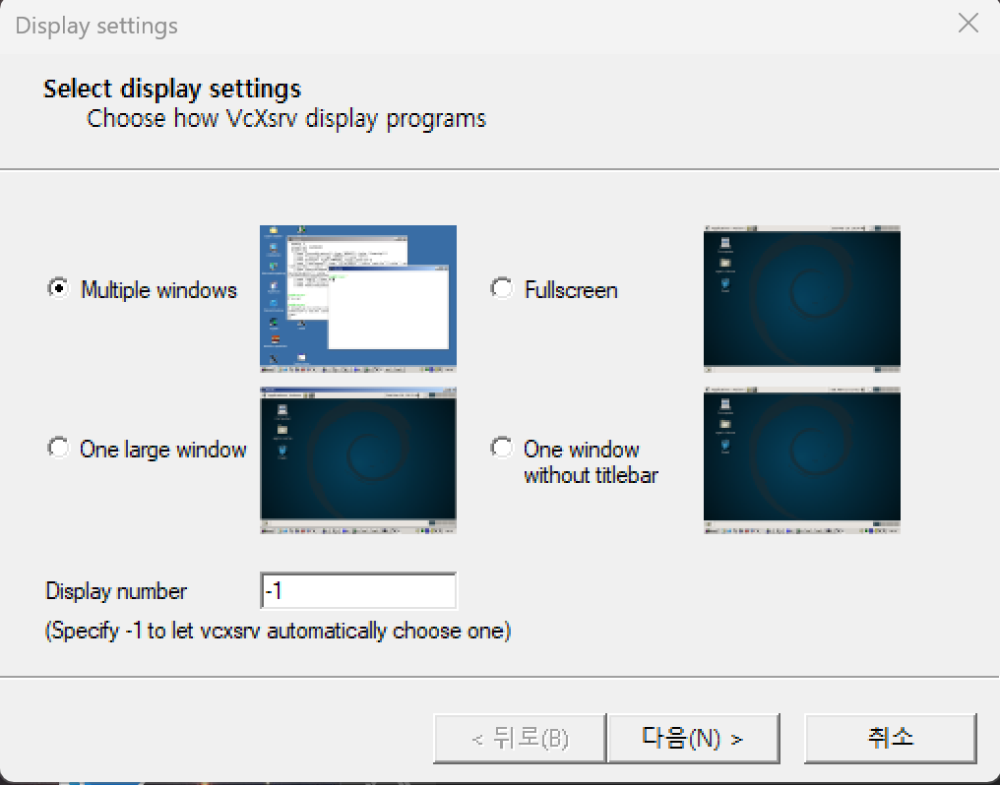
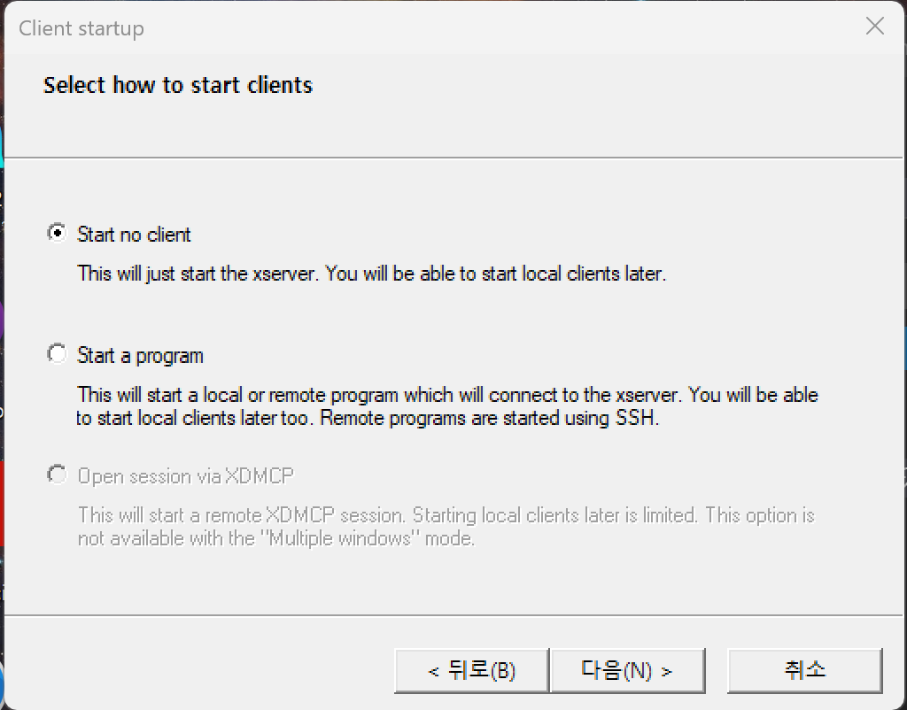
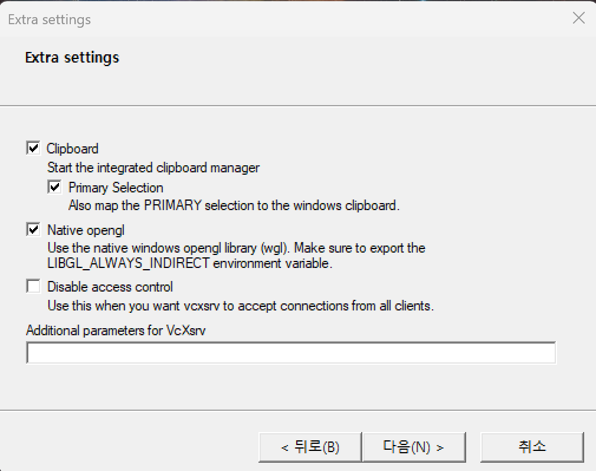

## Tabby 

<br/>

* **Download**   
    https://tabby.sh/   


!!! tip "SSH/Serial/SCP/SFTP"
    - SSH기반의 X11 기능제공 
    - 다양한 WSL 연결 지원     

<br/>

많은 무료 Terminal 존재하며, 편한 것을 사용  

* **이외 Terminal**  
    * Tera Term 
    * Putty 


<br/>

---


### Setup

<br/>


   
   

<br/>

---

### SSH X11 Forwarding 

<br/>

* X11 Setup 
   

<br/>

* C:/Users/LeeJeongHun/.ssh/config
```
Host 192.168.55.1
    HostName 192.168.55.1
    User dyne
    Port 22
    PreferredAuthentications password
    PubkeyAuthentication no
    PasswordAuthentication yes
```


<br/>

### SSH X11 Error 

<br/>

* X11 설정 후 SSH 접속 불량     
**Tabby Profile에서 우선 Password 다시 설정**    
   

<br/>

* 해결되지 않는 다면 다 확인 

* Powershell TEST  
```
ssh -vvv -x 사용자명@192.168.55.1
```

*  문제발생요지
```
C:/Users/LeeJeongHun/.ssh/
C:/Users/LeeJeongHun/.ssh/config
C:/Users/LeeJeongHun/.ssh/know_hosts 
```

* C:/Users/LeeJeongHun/.ssh/config
```
Host 192.168.55.1
    HostName 192.168.55.1
    User dyne
    Port 22
    PreferredAuthentications password
    PubkeyAuthentication no
    PasswordAuthentication yes
```

* C:/Users/LeeJeongHun/.ssh/know_hosts 
상위에서 안된 Key 동일 확인    
```
192.168.55.1 ssh-ed25519 AAAAC3NzaC1lZDI1NTE5AAAAINIMCx8YAEfOUX2zYDrQUZuyAntdhmG3e4ATEpNqunD/
192.168.55.1 ssh-rsa AAAAB3NzaC1yc2EAAAADAQABAAABgQCzIH682ZSNGIuiAxVekLWgdU5ZZvgGFrVmvFH7gKmGWZ1Cm2Gm7B42h272fbpmkyyH/Kj+G+kl63gj4OblE6rv/GjDWAbF1ACc2MyG7wIHAZ/+RCnXytqnv8fj5ML5ocrzxQzOr4MzgmyOzL0i3SdwhoGEtpg30S0K+rFjhVrK+kFR1/f4p1UVvq3ZbMsy933reUMCKPbO12Nuh41DqAi56ci99KbdXbzrQVnd2otMB8if9mMdCTIvCaE5UoB9/98u3K+Jjto3F+WALx0H89j0A05tHDDecS1Du4p7fO3sxriyO4CUvEBxtS0kjFUtxgQga2PpVRToNoE1tgOhH21a/pqBz7VxWR31MmcI9+BF079jptX7FDjKbmhXhuoH0i33GocL+TUgkmD6SicWp8hsfw598dlrIdHw53UZ7sd7J4i6TdXYoiMDYyWVktaZTr5YNyyEhVMXjP+12pyiAJmCp1ci8nHxw/ci5TR79KP3SbuvqKsZKDpQUR6fy5CkL4c=
192.168.55.1 ecdsa-sha2-nistp256 AAAAE2VjZHNhLXNoYTItbmlzdHAyNTYAAAAIbmlzdHAyNTYAAABBBDHnHFfjprdNje26S5jk49SW4qAV7DspOKwJLQ5Q3wiFPhekuN1VpDUmEUqUNg1nSSefR1Z4chZGJ5WKosBDld8=
```

* Powershell 
새로 Key 생성 한 후 Powershell SSH 접속 확인   
```
ssh-keygen -R 192.168.55.1
ssh dyne@192.168.55.1
```

<br/>

---

## XLaunch

<br/>

!!! tip "XLauch"
    - XLaunch 설치 필요   

* **Download**   
https://sourceforge.net/projects/vcxsrv/    
https://sourceforge.net/projects/xming/   


<figure markdown>

 
 
 

<figcaption>
<a href="https://sourceforge.net/projects/vcxsrv/">
Xming XLauch</a>
</figcaption>

</figure>       


* **Docs**     
https://x.cygwin.com/docs/xlaunch/        

<br/>
<br/>

### Ubuntu 

<br/>

* command -v xauth     
xauth가 없다면 설치  
```
sudo apt install xauth
```

* echo "$DISPLAY"
```
localhost:10.0
```